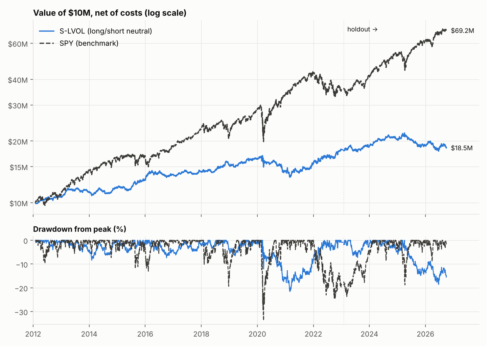

# Informe: long/short neutral a mercado en acciones grandes de EE. UU.

**Para:** Comité de Inversión · **Fecha:** 2026-10-24 · **Estado:** final (holdout evaluado una vez)
**Reproducción:** `uv sync --frozen`, luego `quantlab study configs/equities/study.yaml`,
`validate-equity-study`, `equity-robustness` y `equity-holdout` (snapshot `7bf3f31948ed6974`).

---

## 0. Resumen ejecutivo

**Conclusión: no hay edge validado.** Ninguna de las 11 configuraciones pre-registradas cumple los
criterios:
- DSR ≥ 0.95, estabilidad, PBO y penalización de supervivencia.
- **Ninguna tiene alfa significativo** frente a Fama-French 5 + momentum (mejor t = 0.85).

| Evidencia | Resultado |
|---|---|
| Mejor configuración en research (S-LVOL, bajo riesgo) | Sharpe 0.60, **DSR 0.70** (umbral 0.95; listón por 11 pruebas: Sharpe 0.44) |
| Alfa FF5 + UMD de S-LVOL | +0.8%/año, t = 0.39 → cosecha de primas conocidas (rentabilidad, inversión) |
| S-LVOL en el holdout (2023-02 → 2026-09) | **Sharpe −0.41**, +2.1% total frente a +94.6% de SPY |
| Multifactor (S-COMP) | Sharpe 0.27 en research; −19% en 2020 ("invierno quant") |
| ML (gradient boosting / ridge) | No supera a la combinación simple; IC fuera de muestra ≤ combinación, coeficientes inestables |

**Recomendación:**
- No asignar capital a ninguna de estas estrategias como fuente de retorno.
- S-LVOL sí funcionó como **cobertura** en las caídas de SPY: positivo en 6 de 7 caídas > 5% del
  holdout y +7.4% en 2022.
- Pero su retorno esperado no compensó su coste de oportunidad, y fracasó fuera de muestra.

## 1. Mandato y diseño (pre-registrado: `docs/hypotheses/equities/`)

- **Universo:** Russell-1000-like reconstruido point-in-time (las 1000 mayores por capitalización el
  último día de mayo, vigente de julio a junio).
- **Filtros:** sin financieras; precio ≥ $5; ADV ≥ $10M.
- **Cartera:**
  - Long/short con 40 + 40 nombres, neutral por sector (FF12) y por beta.
  - |peso| ≤ 5%, |neto| ≤ 50%, gross ≤ 200%.
  - Vol objetivo del 10% (solo reduce exposición).
  - Mensual, ejecución t+1.
- **Costes:**
  - Half-spread de 1.5 a 6 pb según ADV, comisión de 0.5 pb, slippage de 1 pb, impacto √.
  - **Préstamo de títulos de 50 pb/año.**
  - AUM de 10M USD.
- **Ventanas:** research 2012–2022; holdout 2023-01 → 2026-09.

## 2. Datos e integridad

- **Fundamentales:** SEC EDGAR XBRL (10.5 M hechos), point-in-time. Se toma el primer valor
  reportado, usable el día después de la presentación. TTM = FY + YTD − YTD previo.
- **Precios:** Yahoo Finance (total return reconstruido con dividendos).
- **Macro:** FRED (BAA10Y, T10Y3M), con 1 sesión de retraso.
- **Look-ahead:** los 8 factores pasan el test adversarial (truncado + futuro aleatorizado).

**Defectos encontrados y corregidos antes de cualquier backtest** (`docs/research_log.md`):
- Acciones multi-clase sin conteo (Alphabet, Meta, Visa).
- Cambios de CIK por reorganización (Exxon, Disney, Medtronic): se enlazan 51 casos con nombre
  idéntico. El fuzzy-matching se descartó porque generaba enlaces falsos.
- Errores de escala XBRL (capitalizaciones de "$17 billones de billones").
- Un bug latente de caché de precios.

**Sesgo de supervivencia (la limitación principal):**
- Solo hay precios de empresas que cotizan hoy. La cobertura del verdadero top-1000 fue de 61% en
  2012, 75% en 2018 y 86% en 2022.
- La medida mezcla empresas muertas con reorganizaciones, así que es conservadora.
- Se penalizó con un arrastre pesimista **definido antes de los resultados** (§5.4 del plan): hasta
  ~1.6%/año en 2012.

## 3. Resultados en research (2012–2022, neto de costes)

| Config | Tesis | Sharpe | DSR | Sharpe tras arrastre | Subperiodos > 0 | Alfa FF5+UMD (t) | Turnover/año | Coste/año |
|---|---|---|---|---|---|---|---|---|
| S-LVOL | Bajo riesgo | **0.60** | **0.70** | 0.40 | 3/4 | +0.8% (0.39) | 3.1 | 0.7% |
| S-MOM | Momentum | 0.37 | 0.41 | 0.22 | 3/4 | +1.8% (0.80) | 5.9 | 1.2% |
| S-COMP | Multifactor | 0.27 | 0.29 | 0.06 | 3/4 | −2.3% (−1.20) | 5.6 | 1.1% |
| S-COMP-MACRO | + overlay crédito | 0.26 | 0.28 | 0.04 | 2/4 | −1.8% (−1.04) | 5.4 | 1.1% |
| S-ML-GBM | ML | 0.20 | 0.21 | −0.04 | 2/4 | +1.7% (0.85) | 7.0 | 1.4% |
| S-RMOM | Momentum residual | 0.12 | 0.15 | −0.08 | 2/4 | −1.4% (−0.71) | 8.0 | 1.5% |
| S-QUAL | Calidad | 0.00 | 0.08 | −0.27 | 2/4 | −1.0% (−0.62) | 3.7 | 0.9% |
| S-VAL | Value | −0.03 | 0.06 | −0.23 | 2/4 | −1.5% (−0.71) | 3.5 | 0.8% |
| S-COMP-OPT | Optimizado (PCA) | −0.11 | 0.04 | −0.25 | 1/4 | −2.7% (−0.79) | 7.1 | 1.6% |
| S-ML-RIDGE | ML | −0.14 | 0.03 | −0.34 | 2/4 | −1.0% (−0.44) | 5.2 | 1.1% |
| S-INV | Inversión | −0.36 | 0.00 | −0.60 | 2/4 | −3.2% (−1.84) | 4.0 | 0.9% |

- PBO = 0.19.
- **Comprobación de que el resultado negativo no es un bug:** cada estrategia carga en su factor
  académico con el signo correcto (S-MOM → UMD +0.48, S-INV → CMA +0.29, S-QUAL → RMW +0.19,
  S-VAL → HML +0.17) y la beta de mercado es ≈ 0.
- **Por qué se ve así:**
  - Value e inversión tuvieron su peor década en acciones grandes.
  - En 2020 el multifactor perdió un 19% y el optimizado un 24%.
- **El overlay macro no aportó:** su max drawdown fue −22.4%, frente a −25.8% de S-COMP, pero con
  menos Sharpe y menos subperiodos positivos.

## 4. Robustez de S-LVOL (research, post-selección)

| Variante | Sharpe | | Variante | Sharpe |
|---|---|---|---|---|
| Base | 0.60 | | Rebalanceo trimestral | 0.62 |
| Costes ×3 | 0.49 | | AUM 1e8 / 1e9 | 0.58 / 0.52 |
| Préstamo ×3 / ×6 | 0.56 / 0.49 | | Sin vol target | 0.55 |
| Lag de 5 días | 0.51 | | 25 / 60 nombres por lado | 0.66 / 0.58 |

Es robusto **dentro** de research. Que fracasara en el holdout apunta a dependencia del régimen, no
a fragilidad de parámetros.

## 5. Holdout frente a SPY

| | Research 2012–22: S-LVOL | SPY | Holdout 2023–26: S-LVOL | SPY |
|---|---|---|---|---|
| Retorno anual | 5.6% | 12.3% | 0.6% | 20.0% |
| Volatilidad | 8.6% | 17.1% | 8.5% | 14.9% |
| Sharpe | 0.60 | 0.73 | **−0.41** | 1.01 |
| Max drawdown | −21.5% | −33.7% | −18.5% | −18.8% |
| Correlación / beta frente a SPY | 0.17 / 0.09 | 1 / 1 | −0.18 / −0.10 | 1 / 1 |

**Caídas de SPY** (> 10% en research, > 5% en holdout):

| Episodio | S-LVOL | SPY |
|---|---|---|
| 2015–16 | +15.3% | −13.0% |
| Q4 2018 | +2.3% | −19.3% |
| COVID 2020 | −11.0% | −33.7% |
| 2022 | +7.4% | −24.5% |
| Aranceles 2025 | +1.9% | −18.8% |

En el holdout, S-LVOL fue positivo en 6 de 7 caídas de SPY.

**Lectura:**
- Es una cobertura efectiva en caídas, pero en mercados alcistas liderados por acciones de beta
  alta pierde.
- En 2023–2026 rindió +0.6%/año frente al 4.5% del cash. Se pagó una "prima de seguro" de cerca de 4
  puntos al año.
- En el holdout, la guardia del ledger lo marcó como **contaminado**: el estudio de ETFs ya había
  usado esa ventana, aunque con otro universo y otra estrategia. Estaba declarado en el plan.

## 6. ¿Aporta el ML?

| Prueba | Ridge | Combinación simple |
|---|---|---|
| CPCV (5 caminos) | IC −0.006 | IC 0.012 (gana en 5/5) |
| Walk-forward estricto | IC 0.006 | IC 0.010 (t de la diferencia −0.3) |
| Cambios de signo de los coeficientes | hasta 14 por feature | — |

La tesis escéptica se sostiene: no hay justificación para un modelo aprendido. El IC de la propia
combinación (~1%) confirma que la señal cross-sectional es débil en este universo y periodo.

## 7. Limitaciones
1. **Supervivencia:** la cobertura fue del 61% al 86% del universo real. Está penalizada pero no
   eliminada, y con datos de pago (CRSP/Norgate) se corregiría.
2. **Universo más profundo que el Russell 1000 real:** los supervivientes rellenan los huecos (el
   puesto 1000 vale $0.66B en 2012, frente a ~$1.5–2B real).
3. Google previo a 2015, UA, FOXA y NWSA no están cubiertos.
4. **Costes de préstamo:** solo general collateral. Los títulos difíciles de prestar se tratan con
   sensibilidad ×3 y ×6, no observados.
5. **Potencia estadística:** 11 años de research y 44 meses de holdout.

## 8. Auditoría
- **Pre-registro:** commit `1ccfcd2`, sin trials de acciones en ese momento.
- **Snapshot:** `7bf3f31948ed6974`.
- **Ledger:** `research/trials.jsonl`, con 11 configuraciones de selección + robustez, 1 evaluación
  final y el desbloqueo registrado.
- **Resultados:** `research/results/equity_study/` (`validation.json`, `robustness/`, `holdout/`).
- **Bitácora completa:** `docs/research_log.md`, con todos los defectos y aclaraciones.
