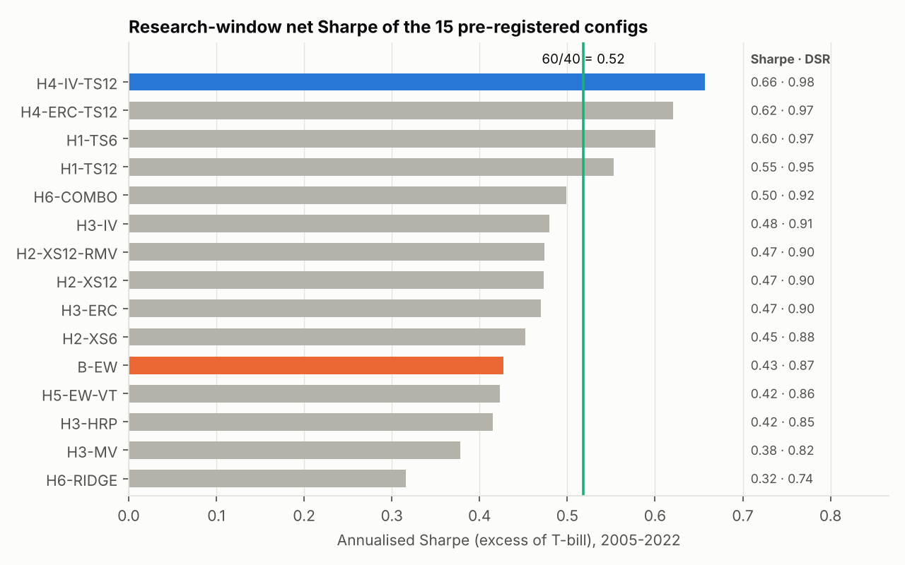
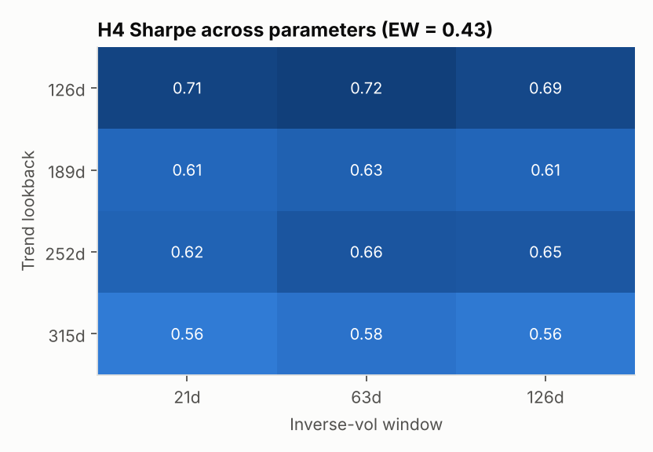
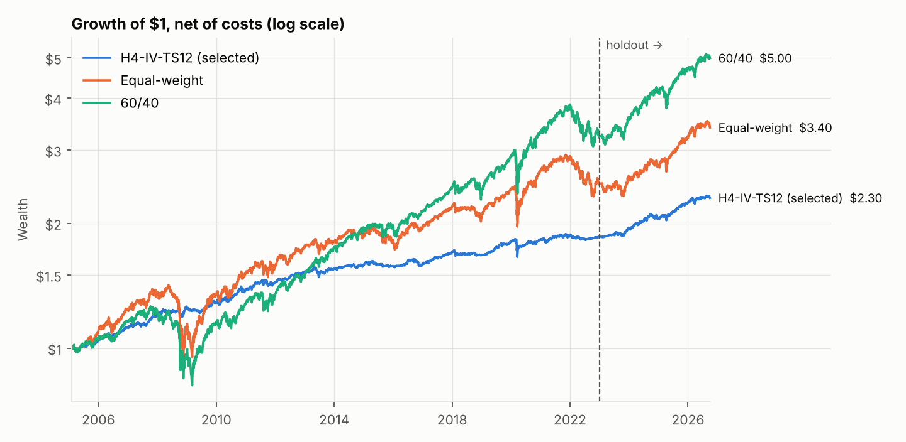
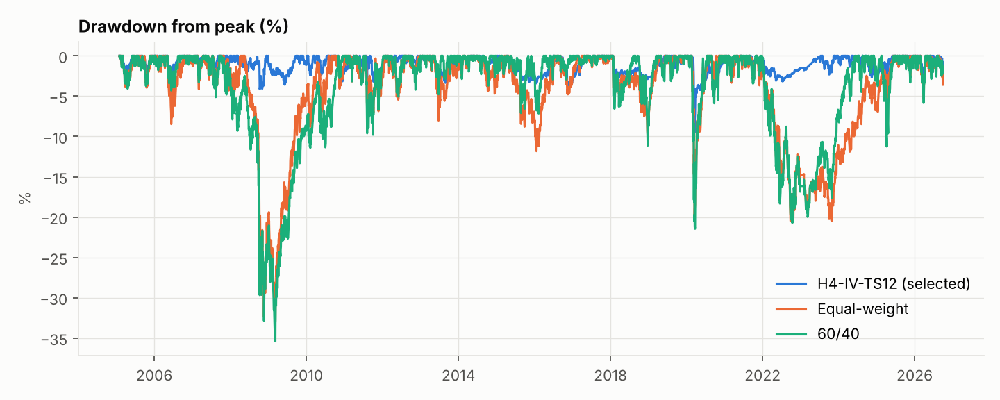

# Informe de investigación: asignación sistemática multi-activo con ETFs

**Para:** Comité de Inversión · **Fecha:** 2026-10-21 · **Estado:** final (holdout evaluado una vez)
**Reproducción:** `uv sync --frozen && make reproduce` (snapshot de datos `32bc5db46626acc8`, commit de este informe)

---

## 0. Resumen ejecutivo

**Conclusión: no encontramos un edge que sobreviva a una validación honesta.** De las 15
configuraciones pre-registradas (trend following, momentum cross-sectional, ponderación por
riesgo, volatility targeting y un modelo de ML), ninguna supera a una cartera equal-weight
de forma estadísticamente defendible y neta de costes.

| Evidencia | Resultado |
|---|---|
| Mejor candidato frente a equal-weight (research 2005–2022) | ΔSharpe +0.25, p = 0.095 (umbral 0.05), IC 95% [−0.20, +0.64] |
| Probabilidad de sobreajuste del proceso de selección (PBO) | **0.60**: elegir "el mejor backtest" no es mejor que el azar |
| Candidato seleccionado (H4-IV-TS12) en el holdout 2023–2026 | Sharpe **0.41**, frente a 0.54 de equal-weight y 0.83 del 60/40 |
| "Elegir cada año al ganador del backtest" (walk-forward) | Sharpe 0.42, frente a 0.47 de promediar todas las reglas |

**Recomendación**, según la regla fijada antes de ver resultados (`docs/hypotheses/STUDY_PLAN.md` §5):
- Adoptar la **cartera de política equal-weight** sobre los 17 ETFs de riesgo
  (5.88% cada uno, con rebalanceo mensual). Es simple, cumple el mandato y su volatilidad
  histórica (~10%) coincide con el objetivo.
- **No** desplegar ninguna regla táctica como fuente de alfa.
- El 60/40 superó a equal-weight en ambas ventanas, aunque sin significancia en el holdout
  (p = 0.89). Elegir entre ambos es una decisión de **asignación estratégica** (creencias
  sobre la prima de la renta variable de EE. UU.), no una conclusión estadística de este
  estudio (§9).

Lo que sí es robusto, pero no es alfa:
- El filtro de tendencia reduce mucho el drawdown en crisis prolongadas: en la GFC, +5% frente a −30%.
- Su elección de activos es mejor que el azar (p = 0.008).
- Su alfa frente a factores de clase de activo no es significativo (t = 1.2), y su retorno
  absoluto (~3.5% anual en research) no es compatible con el objetivo de vol del 10% sin
  apalancamiento. Podría estudiarse como *sleeve* defensivo en otra investigación,
  pre-registrada como tal.

---

## 1. Mandato y pregunta

| Parámetro | Valor (fijado en la Fase 0, antes de ver datos) |
|---|---|
| Universo | 18 ETFs listados en EE. UU.: acciones (SPY, IWM, EFA, EWJ, VGK, EEM), gobierno (SHY, IEF, TLT, AGG), inflación (TIP), crédito (LQD, HYG, EMB), inmobiliario (VNQ), materias primas (GLD, DBC) y cash (BIL, solo como dato) |
| Restricciones | Long-only, sin apalancamiento, máx. 20% por posición, AUM de 1M USD (capacidad probada hasta 10B) |
| Rebalanceo | Mensual; señal al cierre del último día del mes, ejecución al cierre siguiente |
| Benchmark | 60/40 SPY/AGG, rebalanceo mensual, con los mismos costes |
| Objetivo | Volatilidad ~10% y Sharpe neto superior al benchmark |

**Pregunta:** ¿alguna regla sistemática respaldada por la literatura mejora, neta de costes y
de forma estadísticamente defendible, a la cartera ingenua equal-weight?

## 2. Datos e integridad temporal

- **Fuentes:** Yahoo Finance (precios, dividendos y volumen) y FRED `DTB3` (T-bill a 3
  meses, que remunera el cash y es el tipo libre de riesgo).
- **Total return reconstruido**: cierre ajustado por splits más distribuciones en su
  ex-date. Es point-in-time.
  - El "Adj Close" del vendor solo se usa como verificación cruzada: divergencia
    ≤ 1 pb/año, máximo diario 0.12%.
  - Seis splits verificados.
  - Sin huecos internos ni precios inválidos (`docs/data_quality.md`).
- **Snapshot inmutable** `32bc5db46626acc8` (2002-07 → 2026-09) con checksums,
  commiteado en el repositorio.
- **Sin look-ahead por construcción:**
  - Cada componente recibe solo `data.asof(t)`.
  - Ejecución en t+1.
  - Los costes usan liquidez y volatilidad medidas hasta t−1.
  - Cada factor pasa un test adversarial (datos truncados y futuro aleatorizado), y el
    propio test se valida contra 7 tipos de fuga conocidos.
- **Holdout sellado** (2023-01 → 2026-09):
  - Solo accesible mediante un desbloqueo registrado en el ledger.
  - La validación de datos y el informe de calidad nunca mostraron retornos del holdout
    antes de la evaluación final.
- **Costes:**
  - Half-spread de 1–3 pb según clase, comisión de 0.5 pb y slippage de 1 pb.
  - Impacto de raíz cuadrada (k = 0.1·σ·√(orden/ADV)).

## 3. Hipótesis (pre-registradas en `docs/hypotheses/`)

| ID | Tesis | Mecanismo | Configs |
|---|---|---|---|
| H-001 | Time-series momentum: salir de activos con exceso de retorno de 12m (6m) negativo | Infrarreacción y flujos pro-cíclicos | TS6, TS12 |
| H-002 | Momentum cross-sectional (12-1, 6-1) entre clases de activo | Difusión lenta | XS12, XS6, XS12-RMV |
| H-003 | La ponderación por riesgo bate a 1/N en Sharpe | Aversión al apalancamiento | IV, ERC, HRP, MV |
| H-004 | Riesgo + filtro de tendencia | Diversificación entre una prima y un efecto conductual | IV-TS12, ERC-TS12 |
| H-005 | Volatility targeting sin apalancamiento | Clustering de volatilidad | EW-VT |
| H-006 | (Escéptica) ML ridge no mejora una combinación simple de señales | Baja relación señal/ruido | COMBO, RIDGE |

**Presupuesto cerrado:** 15 configuraciones, con BIL fuera del universo de riesgo (el cash
se modela con el T-bill). El orden de los commits es auditable:
1. Pre-registro con el ledger vacío (`41df1f3`).
2. Código de estrategias y estadística (`5e73520`).
3. Ejecución del estudio.

## 4. Metodología de validación

1. **Walk-forward estricto:** todos los parámetros son fijos ex-ante y cada decisión usa
   solo el pasado. El backtest es, en sí mismo, pseudo fuera de muestra. El riesgo de
   sobreajuste está en **elegir entre configuraciones**, y eso se mide con 2–4.
2. **Deflated Sharpe Ratio** (Bailey y López de Prado 2014). Se usa N = 15 trials en la
   selección; como sensibilidad, N = 49 incluyendo las corridas de robustez.
3. **PBO por CSCV** (16 bloques mensuales, 12 870 particiones).
4. **Test de diferencia de Sharpe contra equal-weight:** bootstrap circular por bloques
   de 6 meses, 10 000 réplicas, unilateral.
5. **Estabilidad:** Sharpe positivo en ≥ 3 de 4 subperiodos.
6. **ML:** CPCV con purga y embargo (López de Prado 2018), contrastado con un walk-forward
   estricto.
7. **Holdout de 2023–2026**, evaluado una sola vez para una sola configuración, con
   equal-weight y el 60/40 calculados en la misma corrida.

El **ledger append-only** (`research/trials.jsonl`) registra cada configuración ejecutada:
- 49 trials de research.
- 1 trial final.
- 1 desbloqueo del holdout.

Un hook de git y la CI impiden reescribirlo.

## 5. Resultados en research (2005-02 → 2022-12, neto de costes)

| Config | Sharpe | DSR | ΔSR vs EW | p | Subperiodos > 0 | CAGR | Vol | Max DD | Turnover/año |
|---|---|---|---|---|---|---|---|---|---|
| H4-IV-TS12 | 0.66 | 0.98 | +0.25 | 0.095 | 4/4 | 3.5% | 3.6% | −9.5% | 0.82 |
| H4-ERC-TS12 | 0.62 | 0.97 | +0.20 | 0.163 | 4/4 | 3.4% | 3.6% | −8.1% | 0.69 |
| H1-TS6 | 0.60 | 0.97 | +0.27 | 0.108 | 4/4 | 4.7% | 5.9% | −13.8% | 1.01 |
| H1-TS12 | 0.55 | 0.95 | +0.20 | 0.143 | 4/4 | 4.4% | 6.0% | −10.6% | 0.72 |
| H6-COMBO | 0.50 | 0.92 | +0.13 | 0.265 | 3/4 | 6.5% | 11.6% | −27.8% | 3.47 |
| H3-IV | 0.48 | 0.91 | 0.00 | 0.514 | 3/4 | 3.8% | 5.6% | −17.9% | 0.45 |
| H2-XS12-RMV | 0.47 | 0.90 | −0.01 | 0.540 | 3/4 | 3.3% | 4.6% | −13.7% | 1.04 |
| H2-XS12 | 0.47 | 0.90 | +0.08 | 0.315 | 3/4 | 6.6% | 12.7% | −23.0% | 1.98 |
| H3-ERC | 0.47 | 0.90 | −0.02 | 0.563 | 3/4 | 3.6% | 5.4% | −17.3% | 0.25 |
| H2-XS6 | 0.45 | 0.88 | +0.06 | 0.360 | 3/4 | 6.5% | 13.3% | −33.4% | 3.02 |
| **B-EW (baseline)** | **0.43** | 0.87 | — | — | 4/4 | 5.2% | 10.4% | −32.9% | 0.20 |
| H5-EW-VT | 0.42 | 0.86 | +0.01 | 0.430 | 3/4 | 4.6% | 8.6% | −22.7% | 0.31 |
| H3-HRP | 0.42 | 0.85 | −0.07 | 0.647 | 3/4 | 3.1% | 4.8% | −15.8% | 0.64 |
| H3-MV | 0.38 | 0.82 | −0.11 | 0.750 | 3/4 | 2.7% | 4.2% | −14.4% | 0.47 |
| H6-RIDGE | 0.32 | 0.74 | −0.10 | 0.641 | 4/4 | 4.9% | 14.7% | −34.5% | 4.01 |
| *60/40 (benchmark)* | *0.52* | — | — | — | — | *6.8%* | *11.7%* | *−35.4%* | — |

Cash (T-bill): 1.2% anual en la ventana.

**Lectura de los resultados:**
- **Ningún candidato cumple los cuatro criterios**: ninguno bate a EW con p < 0.05, y además
  PBO = 0.60 ≥ 0.5.
- Los tres primeros superan el DSR de 0.95, lo que confirma que su exceso sobre el cash
  sobrevive a la deflación por 15 trials. Pero eso **no** significa que mejoren a EW.
- Con N = 49 el DSR de H4-IV-TS12 baja a 0.968.
- Las reglas que "ganan" son las que **reducen el riesgo**: tendencia y ponderación por
  riesgo. Su Sharpe sube porque el denominador cae más que el numerador.
- En un mandato sin apalancamiento, esto se traduce en un retorno absoluto bajo.
- **Selección walk-forward:**
  - Elegir cada año al líder del backtest da un Sharpe de 0.42.
  - Promediar las 15 reglas da 0.47, y EW en la misma ventana, 0.37.
  - Elegir al ganador acierta frente a la mediana solo en el 27% de los años.

## 6. Robustez del candidato seleccionado (research, post-selección)

| Prueba | Sharpe H4-IV-TS12 | Comentario |
|---|---|---|
| 12 combinaciones de parámetros | 0.56–0.72 | Siempre por encima de EW (0.43); el original no es un pico aislado |
| Costes ×2 / ×3 / ×5 | 0.64 / 0.63 / 0.60 | Los costes no son el problema |
| Lag de ejecución 2d / 5d | 0.66 / 0.63 | Insensible al timing |
| Rebalanceo trimestral | 0.50 | La variante más débil (DD −14%) |
| AUM 1e7 → 1e10 USD | 0.66 → 0.60 | Sin límite de capacidad relevante |
| Filtro vs. azar (2000 simulaciones) | p = 0.008 | La elección de tendencia tiene información (sesgo post-selección) |
| Alfa frente a 5 factores de clase de activo | +0.7%/año, t = 1.2 | **No significativo**: es sobre todo exposición defensiva |

**Stress histórico** (retorno en la ventana del episodio):

| Episodio | H4-IV-TS12 | Equal-weight | 60/40 |
|---|---|---|---|
| GFC 2007–09 | **+5.3%** | −29.8% | −35.1% |
| Crisis del euro 2011 | −1.4% | −7.9% | −9.4% |
| Taper 2013 | −4.8% | −7.7% | −4.7% |
| China/petróleo 2015–16 | −0.8% | −7.2% | −5.7% |
| Q4 2018 | −1.3% | −7.1% | −10.7% |
| COVID 2020 | −6.9% | −18.3% | −21.2% |
| Shock de tipos 2022 | −1.9% | −19.9% | −20.4% |
| Bancos regionales 2023 *(holdout)* | +0.2% | −0.3% | +0.1% |
| Aranceles 2025 *(holdout)* | −2.8% | −6.8% | −11.1% |

## 7. Holdout (2023-02 → 2026-09, 44 meses, evaluado una vez)

| | H4-IV-TS12 | Equal-weight | 60/40 |
|---|---|---|---|
| Sharpe (exceso de T-bill) | **0.41** | 0.54 | 0.83 |
| CAGR | 6.1% | 8.9% | 12.6% |
| Volatilidad | 3.8% | 8.2% | 9.5% |
| Max drawdown | −3.6% | −7.7% | −11.2% |
| PSR (SR > 0) | 0.78 | 0.85 | 0.95 |

Cash en el holdout: 4.5% anual.

- **Degradación del seleccionado:** 0.66 → 0.41. Pasa del 1º al 3º de los tres, como
  anticipaba el PBO de 0.60.
- **H4 frente a EW en el holdout:** ΔSR −0.11, IC 95% [−0.54, +0.29], p = 0.69.
- **EW frente a 60/40:** ΔSR −0.34, IC 95% [−0.85, +0.29].
- **Con 44 meses el holdout tiene poca potencia**: ninguna diferencia es significativa.
  Aun así, la dirección contradice la superioridad del candidato y es coherente con
  "no hay edge".

## 8. ¿Aporta el ML? (H-006)

| Prueba | Ridge | Combinación simple | Lectura |
|---|---|---|---|
| CPCV (5 caminos, purga + embargo) | IC 0.046 | IC 0.022 | Ridge gana 5/5 caminos; la tesis escéptica queda formalmente refutada **a nivel de IC** |
| Walk-forward estricto (solo pasado) | IC 0.020 | IC 0.017 | Diferencia nula (t = 0.07) |
| Estabilidad de coeficientes | 3–6 cambios de signo por feature | — | Inestable |
| Cartera (backtest) | Sharpe 0.32 (el peor), turnover 4×/año | 0.50 | No se adopta |

La ventaja en CPCV viene de entrenar con bloques **posteriores** al de test, lo que
incorpora información del régimen y no es desplegable. **Conclusión:** con 17 activos y
unos 200 meses, la relación señal/ruido no justifica un modelo aprendido.

## 9. Cartera propuesta y perfil de riesgo

**Cartera de política equal-weight** (decisión al cierre de 2026-09-30, ejecución en la
siguiente sesión):

| ETF | Peso | ETF | Peso | ETF | Peso |
|---|---|---|---|---|---|
| SPY | 5.88% | SHY | 5.88% | LQD | 5.88% |
| IWM | 5.88% | IEF | 5.88% | HYG | 5.88% |
| EFA | 5.88% | TLT | 5.88% | EMB | 5.88% |
| EWJ | 5.88% | AGG | 5.88% | VNQ | 5.88% |
| VGK | 5.88% | TIP | 5.88% | GLD | 5.88% |
| EEM | 5.88% | | | DBC | 5.88% |

Composición por clase: 35% acciones, 24% gobierno, 6% inflación, 18% crédito, 6%
inmobiliario y 12% materias primas.

| Perfil de riesgo | Valor |
|---|---|
| Volatilidad realizada (2005–2026) | 10.1% (research 10.4%, holdout 8.2%) |
| CAGR realizado (2005–2026) | 5.8%, con Sharpe 0.44 (60/40: 7.8%, 0.56) |
| Max drawdown | −32.9% (GFC; ~26 meses bajo el agua); −20.6% en 2022 |
| VaR / CVaR mensual al 95% (research) | 3.9% / 6.6% |
| VaR / CVaR mensual al 99% (research) | 7.1% / 9.9% |
| Exposiciones (betas mensuales, research) | Equity 0.33, duración 0.64, crédito 0.31, commodities 0.09, oro 0.07 (R² 0.94) |
| Turnover | ~0.2/año; coste ≈ 0.01%/año a 1M USD y 0.08% a 10B USD |

**Stress hipotético instantáneo sobre los pesos actuales** (supuestos en `quantlab/risk.py`):

| Escenario | Equal-weight | 60/40 | H4-IV-TS12 (hoy 80% cash) |
|---|---|---|---|
| Caída de acciones −30% con huida a calidad | −14.9% | −16.8% | −5.5% |
| Tipos +200 pb con acciones −15% (tipo 2022) | −13.5% | −13.8% | −2.4% |
| Estanflación | −11.5% | −15.6% | −2.7% |
| Crisis de crédito (HY +500 pb) | −11.8% | −11.6% | −3.8% |

**Justificación:**
1. Es la regla pre-registrada para el caso "ningún candidato validado".
2. No hay parámetros estimados, así que no hay riesgo de sobreajuste.
3. Su volatilidad coincide con el objetivo del mandato sin apalancamiento.
4. Es la cartera más diversificada del conjunto.
5. Su coste es despreciable.

**Lo que el comité debe saber de su elección frente al 60/40:**
- El 60/40 tuvo mejor Sharpe en ambas ventanas.
- Pero esa ventaja se explica por la **excepcionalidad de la renta variable de EE. UU.**
  entre 2009 y 2026. EW tiene un alfa de −1.6%/año frente a factores centrados en EE. UU.
  porque diversifica hacia mercados internacionales, emergentes, real estate y
  commodities, que rindieron menos.
- Elegir ahora el 60/40 por su historial sería el mismo sesgo retrospectivo que este
  estudio intenta evitar.
- Es una decisión de convicción estratégica que corresponde al comité.

## 10. Riesgos y limitaciones

- **Potencia estadística:** unos 215 meses en research y 44 en el holdout. Una ventaja real
  de +0.2 de Sharpe necesitaría varias décadas para ser significativa. Que no haya
  evidencia de edge no prueba que no exista.
- **Survivorship en la elección del universo:** los 18 ETFs son "conocidos hoy". El universo
  se fijó ex-ante y cada activo entra en su fecha de lanzamiento, pero no se incluyen ETFs
  cerrados.
- **Un solo proveedor gratuito de precios:** se mitigó reconstruyendo el total return y
  contrastándolo con el vendor. Las capas de datos son adaptadores intercambiables.
- **Modelo de costes calibrado, no observado:** los spreads son supuestos razonables para
  ETFs líquidos. La conclusión no depende de ellos (×5 no la cambia).
- **Régimen de tipos:** la muestra research incluye una larga etapa de tipos cerca de cero
  (cash al 1.2%) y el holdout, tipos altos (4.5%). Las reglas defensivas, muy cargadas de
  cash, se comportan distinto según el régimen.
- **El investigador no estaba ciego** a los rendimientos agregados de los activos en la
  ventana research (informe de calidad de datos) antes del pre-registro. Las hipótesis
  vienen de la literatura.
- **Los tests post-selección** (filtro contra azar, robustez) son optimistas por
  construcción.
- **Escenarios hipotéticos:** son supuestos (duraciones y betas de crisis), no previsiones.

## 11. Reproducibilidad y auditoría

| Elemento | Dónde |
|---|---|
| Entorno exacto | `uv.lock` (`uv sync --frozen`) |
| Datos | `data/snapshots/32bc5db46626acc8/` (checksums verificados al cargar) |
| Configuraciones | `configs/base.yaml`, `configs/study.yaml` (con hash de cada una) |
| Pre-registro | `docs/hypotheses/` (commit `41df1f3`, ledger vacío) |
| Registro de pruebas | `research/trials.jsonl` (append-only, verificado por hook y CI) |
| Bitácora completa, incluidos errores | `docs/research_log.md` |
| Resultados | `research/results/study/` (retornos, métricas, `validation.json`, robustez, holdout) |
| Un comando | `make reproduce` (idempotente: re-ejecutar no añade trials ni desbloqueos) |
| Tests | 110 tests, incluidos tests adversariales de look-ahead (`make test`, `make leakage`) |
